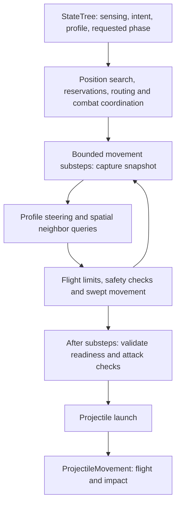

# FlyingSwarmCombatSim

A flying swarm combat simulation set inside a cave, built in Unreal Engine 5.8. Pilot a flying ship through enclosed rock formations while fighting agents that flock, pursue, spread around you and fire from moving positions. The project combines a playable combat loop with configurable AI behavior and live visual tools for understanding and tuning the swarm.

> **Gameplay footage - capture pending:** flight through the environment, swarm acquisition, ranged combat, and death/spectate/retry.
>
> **Debug capture - capture pending:** independent State, Spatial and Collision views, followed by focused-agent inspection during a behavior transition.

## Gameplay features

- **Pilot a flying ship through a cave:** move forward, backward and sideways relative to the view, including along the direction of an upward or downward look. Acceleration and braking shape the handling, while the ship pitches and banks visually as you steer. Camera-driven ship fading helps preserve the view when the camera moves close or the viewing angle would put the ship in the way.
- **Fight a swarm that changes behavior around you:** agents wander and flock before detecting the ship, then approach, spread into firing positions and orbit the player. Closing the gap can force them to retreat; moving through tighter cave spaces changes which positions and ranges are usable. Separation, alignment and cohesion shape how tightly agents group and how similarly they fly.
- **Use the cave to break sight and change the chase:** rock formations can obstruct movement and shots. Agents take clear direct paths where they fit and use authored waypoint routes around blocked passages. After losing sight, they can pursue the ship's last observed location, then return to wandering when pursuit ends or reacquire the ship when it becomes visible again.
- **Shoot from the ship while dodging incoming fire:** the player weapon uses hitscan with a visible shot beam and impact presentation. Camera aim and the ship's muzzle path both matter, so nearby rock can block a shot. Enemies launch traveling projectiles that lead the moving ship, with varied firing times and optional fan patterns that spread pressure across the player's flight path.
- **Read combat through sound and screen feedback:** Player shots and enemy projectiles have audio, while damaging hits on enemies and the player have hit audio. Taking damage produces a brief camera shake and a red vignette flash around the screen edges, keeping the center readable during combat. Health and enemy death make the outcome of an exchange visible.
- **Face replenishing pressure from authored entrances:** separate spawn volumes let encounters feed agents from chosen pockets of the cave. A population sensor counts living agents in its region and schedules individual replacements below its quota, with configurable initial delay and spawn intervals. Population builds over time instead of instantly filling the quota.
- **Review a run without stopping the simulation:** the HUD tracks survival time, kills, shots, hits, accuracy and damage dealt. On death, those results freeze while the cave and swarm keep running; free-camera spectating lets you continue observing the encounter. Retry reloads the current level for a fresh attempt with reset combat and run state.

## How the behavior is produced

### Distributed firing positions

The ranged planner samples directions on a **Fibonacci sphere**. Successive points use the golden angle, `pi * (3 - sqrt(5))`, with evenly stepped height coordinates to distribute candidates across a sphere. Each agent rotates the whole sample set using its seed, preserving the distribution while varying its options.

Directions become target-relative positions on range shells. Candidates must satisfy bounds, body clearance, target visibility and route requirements. Valid choices are scored for openness, spacing from living agents and reserved destinations, travel cost and range preference, with a small seeded directional bias. Reservations let later decisions account for positions other agents already selected; a required score improvement reduces unnecessary switching.

Fibonacci sampling supplies coverage. Seeded variation, scoring and reservations encourage agents to spread out; they do not assign guaranteed unique, permanently occupied slots.

### Range control, orbit and retreat

Minimum, preferred and maximum ranges define the engagement band. The planner can search smaller adaptive shells when nominal space is unavailable. The combat coordinator resolves requested phases against the actual position, route and clearance, allowing approach, retreat, orbit or a hold with an observable reason.

Orbit steering rotates the radial direction around an orbit axis, then corrects radius and height toward their targets. Exponential correction uses `1 - exp(-gain * dt)` to approach those targets without correction overshoot. The predicted finite movement step is checked against range and collision constraints. Readiness is revalidated after movement; requesting Orbit or reaching a destination does not by itself authorize firing.

### Obstacle-aware navigation

Routing first checks a direct segment with the agent's body radius and clearance margin. If blocked in authored-route mode, **incremental A*** searches explicit waypoint connections using traveled distance plus a Euclidean goal heuristic. Collision checks validate attachments and edges; query and expansion budgets spread searches across frames.

Rooms supply spatial metadata, while designers author the waypoint links. Local steering handles nearby motion and proactive avoidance; mandatory sweeps, bounds and braking still protect flight. Remembered-location pursuit uses the last observed goal rather than tracking an unseen player's live position.

### Steering profiles and individual variation

Reusable **steering profiles** combine primary movement with weighted Separation, Alignment and Cohesion. Proactive Obstacle Avoidance modifies the resulting direction. Wander supplies seeded yaw/pitch drift; Path Following drives approach, retreat and transit; Orbit supplies angular movement and correction.

Profiles are selected by StateTree tasks. This supports different spacing and flocking by behavior: for example, a compact Wander profile and a more dispersed pursuit profile with a larger Separation Distance. Weights change relative influence; distance controls change where that influence applies.

Each movement substep reads a captured population snapshot, with a spatial index narrowing neighbor searches before exact filtering. Shared profile assets hold configuration; random streams, timers and held avoidance directions belong to individual agents. Speed, turn rate, acceleration, braking, collision and recovery constrain the final movement.

### Predictive fire and attack patterns

Predictive aiming solves `|relativePosition + targetVelocity * t| = projectileSpeed * t` for a positive intercept time. Prediction is limited by a configurable time horizon and projectile lifespan, then scaled by Prediction Strength. If no usable solution exists, aim falls back to the current target position.

Per-agent seeded cadence variation staggers attempts. Fan attacks distribute shots across an angle oriented using the target's lateral motion, with a fallback orientation at low lateral speed. Active attack context, live visibility/eligibility and muzzle/projectile clearance checks still govern launch.

## Simulation pipeline

`USwarmSimulationSubsystem` owns swarm stepping and commits boid movement. Planning runs before movement substeps; readiness and subscribed attack checks follow movement. StateTree tasks express intent and activate attack context rather than moving actors. Enemy projectile flight belongs to its own ProjectileMovement component.

## Designer workflow and visual testing

Behavior is authored through StateTrees, reusable steering Data Assets, boid/attack Blueprint defaults, project settings and placed navigation/spawn actors. Profiles let designers change one state's flight style without retuning every state. Debug tools make the result observable during gameplay and spectating:

- **Agent State:** awareness/combat badges, health and attack timing indicators.
- **Spatial:** current destination or hold marker, remaining route, goal distance and velocity.
- **Collision:** agent mesh silhouettes plus enemy projectile rings derived from the live collision sphere. Silhouettes communicate awareness; they are not exact agent hitboxes.
- **Focused agent:** select near the crosshair or visible cursor for a persistent live inspector. Compare requested intent with resolved movement, the evaluated profile, sensing, routing/hold reasons, steering contributions and actual movement outcomes. It does not pause play or take over the camera.

Input mappings, colors, typography, badge distance scaling and inspector presentation are configurable. The focused inspector reports simulation facts and the assigned tree; it does not claim exact active StateTree task inspection.

Core authoring controls live in StateTree tasks and their assigned steering profiles, agent and AttackComponent Blueprint defaults, Project Settings > Game > Swarm Simulation, and placed bounds, waypoint and spawn actors. Profiles expose behavior weights, spacing distances and neighborhood controls; attack defaults expose cadence, prediction and fan settings. Debug presentation is authored on the player controller, and keys are assigned in IMC_Debug. Project simulation settings and attack configuration are copied at initialization, so use a fresh run after changing those defaults.

## Run

Open the project in Unreal Engine 5.8 and run.

## Production & Architecture Status

To validate the core math, gameplay behavior and designer iteration loop quickly, the initial implementation used a centralized simulation architecture. Current refactoring focuses on separating that implementation into smaller, modular actor components with clearer responsibilities, while preserving the established gameplay and designer-facing workflows.
